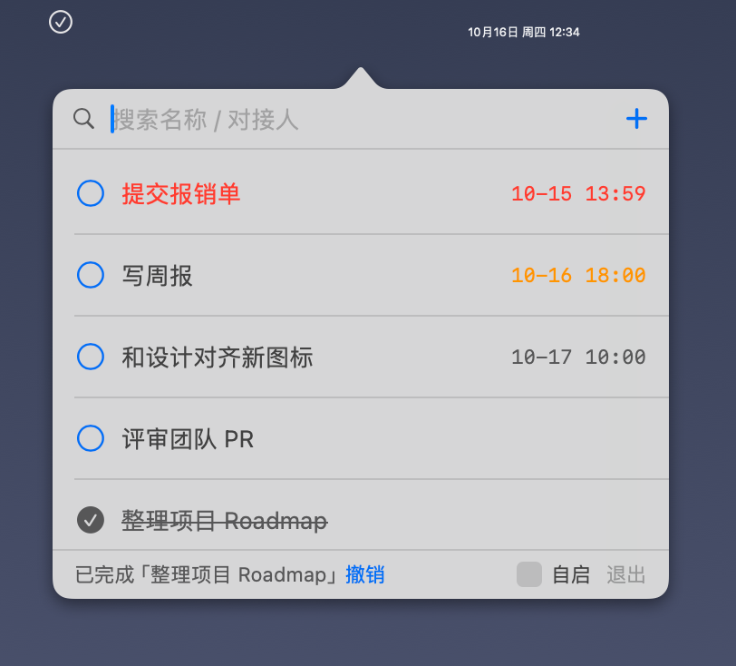
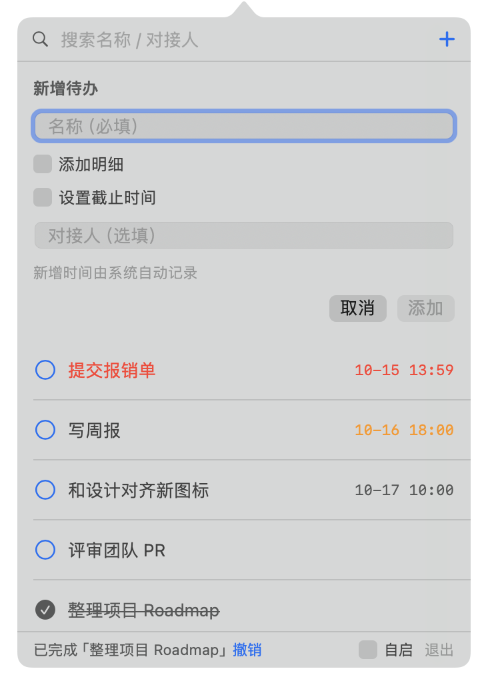
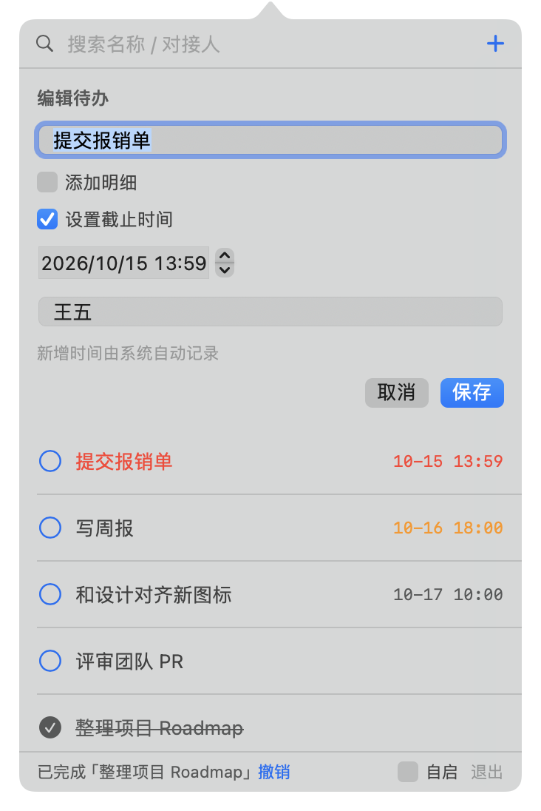
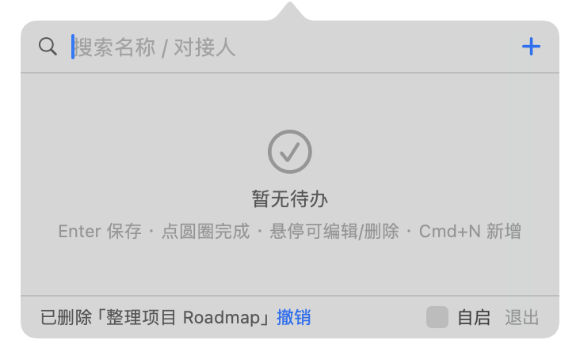

<div align="center">

# TodoMenu

**极简的 macOS 菜单栏待办清单** · A minimal menu bar todo list for macOS

[](https://github.com/aMetric/todoMenu/actions/workflows/ci.yml)
[](LICENSE)
[](https://github.com/aMetric/todoMenu)
[](https://www.swift.org)
[](https://github.com/aMetric/todoMenu)
[](https://github.com/aMetric/todoMenu)

</div>

常驻菜单栏的勾选图标，点击弹出极简待办面板。**数据只存在本机，无账号、无网络。** 原生 SwiftUI 实现，包体约 400KB。

A checkmark icon lives in your menu bar; click it to open a tiny todo panel. **Local-only. No account. No network.** Native SwiftUI, ~400KB.

## 预览 Preview



点菜单栏勾选图标即开面板：列表按**紧急度排序**（逾期红、今天橙），底部摘要随时告诉你"几条待办、几条逾期"。

## 🖼 核心功能 Function Tour

### 秒记一条：Cmd+N 或点 ➕



表单自动聚焦名称，**Enter 保存、Esc 收起**。"添加明细"可展开多行输入——开会时领导点评的几句话，原样记下来。

### 编辑：悬停行出 ✏️



改名称、改截止时间、补明细、换对接人，原条目原地更新（新增时间不变）。

### 误删有后悔药


删除或勾选完成后，底部出现 **撤销条（4 秒内有效）**，点"撤销"或按 **Cmd+Z** 即恢复。

### 空状态引导



第一次打开不迷路：一行提示讲完全部操作。

## ✨ 特性 Features

- 🖥 常驻菜单栏（SF Symbols 勾选图标，自动适配明暗模式），不占 Dock，点击面板外自动收起
- 🔍 顶部搜索框（按名称 / 明细 / 对接人实时过滤）+ 右侧 ➕ 按钮
- 📋 列表最多显示 5 条，超出后列表内部滚动
- ➕ 新增待办：名称（必填）、明细（选填，多行：会议要点 / 领导原话）、截止时间（可留空）、对接人（选填）；**新增时间自动记录**
- 👆 鼠标悬停某条时展示完整信息（名称 / 明细 / 截止时间 / 对接人 / 新增时间）
- ⏰ 截止时间已过标红、当天标橙；勾选完成后划线置灰
- 🔥 列表按紧急度排序：逾期 > 今天到期 > 未来有截止时间 > 无截止时间 > 已完成
- 💾 数据本地存储：`~/Library/Application Support/TodoMenu/todos.json`（带版本号，损坏自动备份重建）

## 安装 Installation

### 下载安装包（推荐，无需编译）

前往 [Releases](../../releases) 下载最新版：

- **`.dmg`**（推荐）：双击打开，把 TodoMenu 拖入 Applications 即可
- `.zip`：解压后把 TodoMenu.app 拖入 `/Applications`

两者都是开箱即用的 Universal 二进制（Apple Silicon + Intel），macOS 14+。

> 当前版本使用 ad-hoc 签名（无需 Apple 开发者账号）。首次打开若被拦截，**右键 → 打开**即可。

### 从源码构建

```bash
git clone git@github.com:aMetric/todoMenu.git
cd todoMenu
./scripts/bundle.sh          # 产出 Universal .app（arm64 + x86_64）
open build/TodoMenu.app
```

### Homebrew

`brew install --cask todo-menu` 计划在首个正式 Release 后提交至 homebrew-cask。欢迎通过 [Issue](../../issues) 催更或共建。

## 使用 Usage

1. 菜单栏点击勾选图标打开面板
2. 点右上角 **+** 或按 **Cmd+N** 新增待办：名称（必填）、明细（选填，可多行）、截止时间（可留空）、对接人（选填）
3. 点击行首圆圈标记完成；悬停该行出现 ✏️ 可编辑、🗑 可删除
4. **Cmd+N** 快速新增（表单自动聚焦名称，Enter 保存，Esc 收起）
5. 删除 / 完成后 4 秒内可点底部 **撤销**（或 **Cmd+Z**）恢复
6. 面板底部 **自启** 开关可设置登录 macOS 后自动启动（系统登录项，可在系统设置中管理）
7. 面板右下角 **退出** 可退出应用

## 数据与隐私 Data & Privacy

- 全部数据保存在本机单文件 `~/Library/Application Support/TodoMenu/todos.json`（JSON，UTF-8，带版本号）
- 无任何网络请求、无埋点、无第三方 SDK
- 删除应用时同步删除该目录即可彻底清除数据

## 兼容性 Compatibility

| 环境 | 状态 |
| --- | --- |
| macOS 15 (Sequoia) | ✅ CI 持续验证 |
| **macOS 14 (Sonoma)** | ✅ **最低支持版本**，CI 持续验证 |
| macOS 13 及更早 | ❌ 不支持 |
| Apple Silicon (M1+) | ✅ Universal 二进制 |
| Intel | ✅ Universal 二进制 |

部署目标固定为 macOS 14.0，所有 API 均受编译器可用性检查约束，保证不依赖更高版本系统能力。

## 开发 Development

环境要求：macOS 14+，Swift 5.9+（仅需 Xcode Command Line Tools，无需完整 Xcode）。

```bash
swift run                    # 直接运行（开发调试，本机架构）
./scripts/bundle.sh          # 打包 Universal .app

# 自动化冒烟测试：模拟表单开合、增删改操作，验证无崩溃且弹层尺寸同步
./build/TodoMenu.app/Contents/MacOS/TodoMenu --selftest

# 生成文档截图（示例数据，不读真实数据）
./build/TodoMenu.app/Contents/MacOS/TodoMenu --shot panel=docs/shots/panel.png
./build/TodoMenu.app/Contents/MacOS/TodoMenu --shot form=docs/shots/form.png
# 场景：panel（含合成菜单栏）/ form / edit / undo / empty
```

架构说明见 [PLAN.md](PLAN.md)（方案、数据模型、兼容性策略、实现备注）。

## 项目结构 Structure

```text
Package.swift                 # SPM 工程定义（macOS 14+，零依赖）
Sources/TodoMenu/             # SwiftUI 源码（AppKit 外壳 + SwiftUI 视图）
scripts/bundle.sh             # 一键打包 Universal .app
.github/workflows/ci.yml      # CI：macOS 14/15 构建 + 自测 + 产物
docs/                         # 截图等资源
PLAN.md                       # 方案与需求文档
CHANGELOG.md                  # 变更日志
```

## Roadmap

- v0.4：系统通知提醒（到点 / 逾期 / 稍后提醒）、截止时间快捷预设、全局快捷键快速新增
- v1.1：导出 / 导入、备份恢复、菜单栏图标主题
- v1.2：优先级 / 标签、可选的 iCloud 同步、App 图标

欢迎在 [Issues](../../issues) 提需求投票。

## 贡献 Contributing

欢迎任何形式的贡献：Bug 报告、功能建议、文档、代码。请先阅读 [CONTRIBUTING.md](CONTRIBUTING.md)。

- 行为准则：[CODE_OF_CONDUCT.md](CODE_OF_CONDUCT.md)
- 安全漏洞报告：[SECURITY.md](SECURITY.md)
- 变更日志：[CHANGELOG.md](CHANGELOG.md)

## 开源协议 License

[MIT](LICENSE) © 2025 TodoMenu contributors
